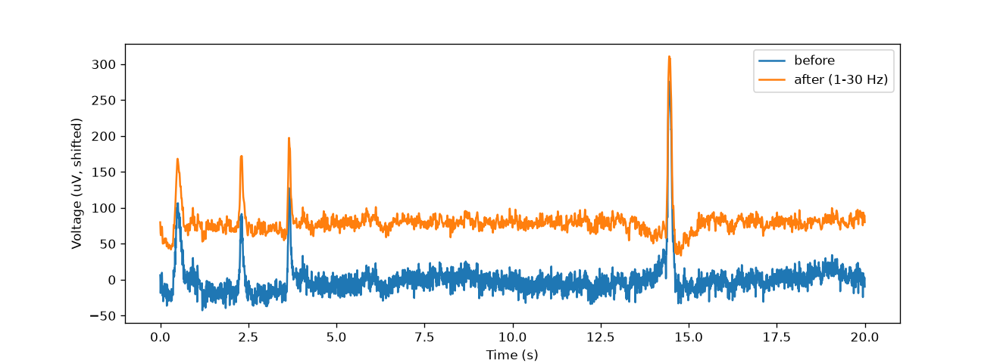
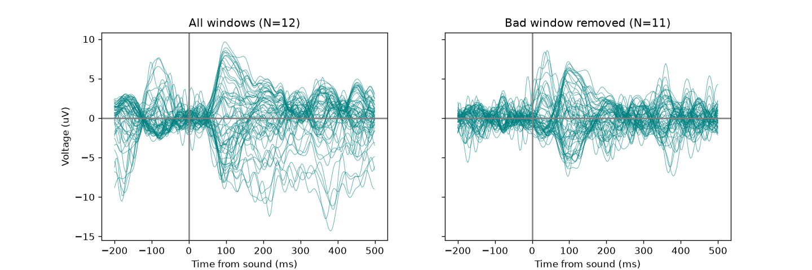
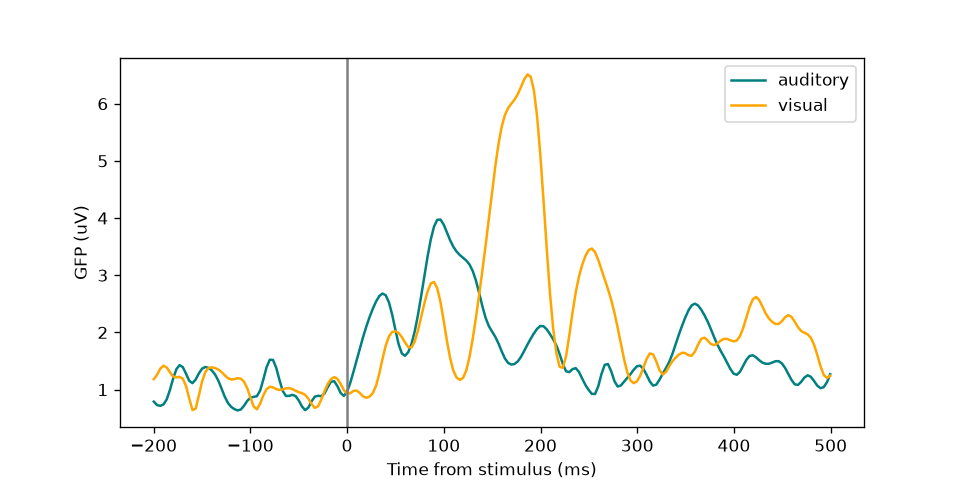
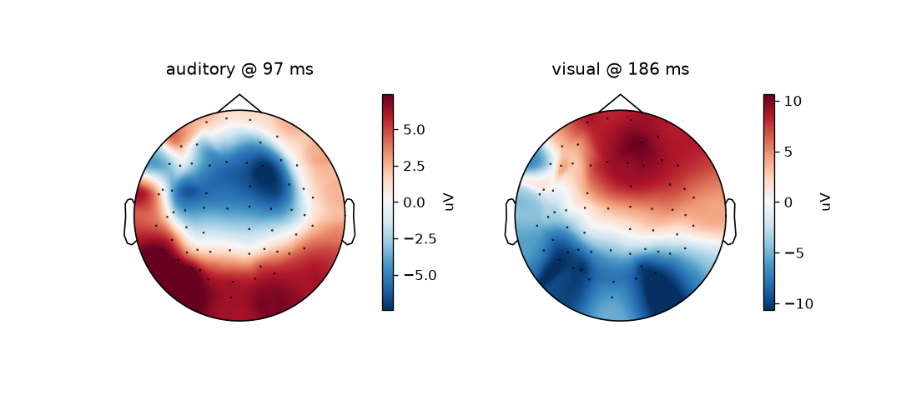

# EEG Event-Related Potential (ERP) Analysis with MNE-Python

A complete, beginner-built EEG analysis pipeline: load a real recording, clean it, cut it into windows around sounds and pictures, average the windows, and test whether the brain's response to pictures differs from its response to sounds.

This is a **learning project**. It uses a single 20-second recording from one person, so the results describe that recording only. The [Limitations](#limitations) section explains exactly what can and cannot be concluded.

## Contents

- [What this project does](#what-this-project-does)
- [Data](#data)
- [Setup and usage](#setup-and-usage)
- [Pipeline, step by step](#pipeline-step-by-step)
- [Results](#results)
- [Limitations](#limitations)
- [Glossary](#glossary)
- [Next steps](#next-steps)
- [Credits](#credits)

## What this project does

The script answers one question: **when a person hears a sound or sees a picture, what does the scalp EEG look like, and do the two responses differ?**

It covers the standard workflow of an ERP analysis:

1. Load and inspect a raw EEG recording.
2. Filter out slow drift and fast noise.
3. Detect and repair a broken (flat) channel.
4. Re-reference to the average of all channels.
5. Find stimulus events and cut the signal into short windows (epochs).
6. Reject a window contaminated by a large artifact.
7. Average the windows to get the evoked response.
8. Measure response strength over time (global field power) and across the head (topographic maps).
9. Test the sound-versus-picture difference with a permutation test.

## Data

The recording is the truncated `sample_audvis_trunc_raw.fif` file from the MNE testing data repository (a short slice of MNE's "sample" dataset). One person heard tones in the left or right ear and saw checkerboards on the left or right side of the screen.

| Property | Value |
|---|---|
| Duration | about 20 s (6007 samples) |
| Sampling rate | 300.3 Hz |
| Channels | 376: 60 EEG, 204 gradiometers and 102 magnetometers (MEG), 9 stimulus, 1 EOG |
| Recording-time filter | 0.1 to 80 Hz |
| Marked bad channels | `EEG 053`, `MEG 2443` |
| Stimulus events | 25 in total |

Event codes found on stimulus channel `STI 014`:

| Code | Meaning | Count |
|---|---|---|
| 1 | Sound, left ear | 6 |
| 2 | Sound, right ear | 6 |
| 3 | Picture, left | 6 |
| 4 | Picture, right | 5 |
| 5 | Smiley face | 1 |
| 32 | Button press | 1 |

Only codes 1 to 4 are used for the analysis. Only the EEG channels are analyzed; the MEG channels are ignored.

The data is **not stored in this repository**. Download it as described below. See the [MNE testing data repository](https://github.com/mne-tools/mne-testing-data) for its terms of use.

## Setup and usage

Tested with Python 3 on Linux (Kali). Library versions are pinned in `requirements.txt`.

```bash
# 1. Get the code
git clone https://github.com/MrWater00/eeg-erp-analysis.git
cd eeg-erp-analysis

# 2. Create an isolated environment and install dependencies
python3 -m venv .venv
source .venv/bin/activate
pip install -r requirements.txt

# 3. Download the data (about 12 MB)
mkdir -p data
wget -P data https://raw.githubusercontent.com/mne-tools/mne-testing-data/master/MEG/sample/sample_audvis_trunc_raw.fif

# 4. Run the analysis
python3 eeg_erp_analysis.py
```

The script prints its progress and results to the terminal and saves figures as PNG files in the current folder. If you are on a machine without a display, the figures are written to files instead of shown in windows.

## Pipeline, step by step

### 1. Load and inspect
The raw file is read with MNE into memory. The script reads the channel counts, sampling rate, and the list of channels already marked bad, then converts the EEG values from volts to microvolts (µV) and plots a few channels over time. Values are checked against the typical EEG range (a few µV up to a few tens of µV).

### 2. Event detection
Stimulus markers are read from `STI 014` with `mne.find_events`. MNE reports sample numbers counted from when the recording machine started, not from the start of this slice, so the script subtracts `raw.first_samp` before converting to seconds. The first event falls at 3.62 s.

### 3. Band-pass filtering (1 to 30 Hz)
A zero-phase FIR band-pass filter removes slow drift (below 1 Hz) and fast noise (above 30 Hz). The filter is applied to a **copy** of the raw data so the original stays available for comparison. Zero-phase filtering does not shift the timing of peaks, which matters for ERPs.

Large bumps in the front channels (near 0.5, 2.3, 3.65 and 14.45 s) survive the filter, because they fall inside the 1 to 30 Hz band. Filtering cannot remove them.

| Bump near | Peak height before (µV) | After (µV) |
|---|---|---|
| 0.5 s | 109 | 90 |
| 2.3 s | 94 | 94 |
| 3.65 s | 130 | 119 |
| 14.45 s | 278 | 232 |



### 4. Bad-channel detection and repair
The standard deviation of each EEG channel is computed. `EEG 053` has a standard deviation of 0.6 µV, while the other 59 channels range from about 7.9 to 21.5 µV, so the channel is essentially flat. It is rebuilt by spline interpolation from the 59 other electrodes using their 3D positions.

An interpolated channel is an **estimate** built from its neighbors. It adds no new information.

### 5. Average reference
Every channel is re-expressed relative to the average of all 60 EEG channels at each moment. After this step the sum across channels is zero at every time point (up to rounding error), which the script checks.

### 6. Epoching
Windows run from 0.2 s before to 0.5 s after each stimulus (211 samples per window). The baseline is the mean of the pre-stimulus part of each window, which is subtracted so every window starts at a common zero level. Without rejection this gives 23 windows of shape (23, 60, 211).

### 7. Artifact rejection
Windows whose peak-to-peak amplitude exceeds 150 µV on any EEG channel are dropped. One window is rejected: the sound in the right ear at 14.54 s, flagged on `EEG 001`, `EEG 002`, `EEG 003` and `EEG 007`, which are among the most frontal electrodes. This removes a late dip near 380 ms that was distorting the auditory average, and lowers the largest absolute value in the auditory average from 14.28 µV to 8.56 µV. The cause of the artifact was not identified.

The remaining 22 windows are split as: sound left 6, sound right 5, picture left 6, picture right 5.



### 8. Evoked responses, global field power and topographic maps
Windows are averaged by condition (auditory: 11 windows, visual: 11 windows). **Global field power (GFP)** is the standard deviation across the 60 channels at each moment, giving one number per time point that summarizes the strength of the response over the whole head. Topographic maps show the voltage at each electrode at the GFP peak of each condition.




### 9. Permutation test
For each of the 22 windows, a single "response strength" value is computed: the standard deviation across channels, averaged over 150 to 220 ms. The difference between the picture and sound means is compared with 5000 random shuffles of the condition labels (fixed seed: `numpy.random.default_rng(0)`). The p-value is `(count + 1) / (n_shuffles + 1)`, where `count` is the number of shuffles with an absolute difference at least as large as the real one.

## Results

| Measure | Sound | Picture |
|---|---|---|
| Windows averaged | 11 | 11 |
| GFP peak time (searched 50 to 300 ms) | 96.6 ms | 186.5 ms |
| GFP peak height | 3.97 µV | 6.51 µV |
| Pre-stimulus GFP level (noise floor) | about 1 µV | about 1 µV |

- Both responses rise clearly above the pre-stimulus noise floor. The sound response peaks first, near 100 ms, and the picture response peaks later, near 185 ms. The picture response also has a smaller bump near 90 ms and another near 250 ms, so a single peak number does not describe its whole shape.
- The topographic maps differ between conditions. For sound, the voltage is negative over the upper-central scalp and positive toward the back. For pictures, the pattern is reversed: positive toward the front and negative toward the back.
- Permutation test (150 to 220 ms window): mean response strength is 4.94 µV for sound windows and 6.74 µV for picture windows, a difference of 1.804 µV. Only 1 of 5000 shuffles produced a difference this large (p = 0.0004). With 5000 shuffles the smallest possible p-value is about 0.0002, so this is best reported as **p < 0.001**.

## Limitations

Read these before using any number from this project.

- **One person, 20 seconds, 11 windows per condition.** The averages and the peak times are sensitive to individual windows. Removing or adding one window could shift peak times by tens of milliseconds. Nothing here generalizes to people in general.
- **The test window was chosen from the same data.** The 150 to 220 ms window was picked because it contains the picture response peak seen in these same windows. This makes the p-value optimistic. A fair test would fix the window in advance or choose it using separate data.
- **Windows are not fully independent.** They come one after another in the same session, and the person's state can drift over time. A permutation test that shuffles labels assumes the windows can be exchanged freely.
- **GFP measures total spread across channels**, not the response at any particular location, and noise adds to it.
- **Eye and movement artifacts are handled crudely.** A fixed 150 µV threshold drops whole windows. Large front-channel bumps are probably eye blinks, but the cause of the rejected 14.54 s artifact was not confirmed. Methods such as independent component analysis (ICA) would be better.
- **The interpolated channel is not real data.**
- **Average referencing assumes reasonably even electrode coverage over the head.**
- **Edge effects.** The filter is about 3.3 s long, which is long relative to a 20 s recording, so the very beginning and end of the data can be slightly distorted.
- **EEG is spatially blurry.** The topographic maps show the voltage pattern on the scalp, not the location of the neurons that produced it.

## Glossary

- **EEG (electroencephalography):** recording the brain's electrical activity with electrodes on the scalp. Good at timing, poor at location.
- **Channel:** one electrode's signal over time.
- **Sampling rate:** measurements per second (here 300.3 Hz).
- **Microvolt (µV):** one millionth of a volt. MNE stores data in volts.
- **Reference:** the zero point against which voltages are measured. An average reference uses the mean of all channels.
- **Band-pass filter:** keeps frequencies inside a band (here 1 to 30 Hz) and removes the rest.
- **Epoch:** a short window of data around a stimulus.
- **Baseline:** the pre-stimulus part of an epoch, used to set the zero level.
- **Evoked response / ERP:** the average of many epochs, in which random noise partly cancels and the stimulus-locked response remains.
- **GFP (global field power):** standard deviation across all channels at each moment.
- **Topomap:** a head map showing the voltage at each electrode at one moment.
- **Permutation test:** shuffles the condition labels many times to see how big a difference luck alone produces.
- **p-value:** the fraction of shuffles (including the real one) that produce a difference at least as large as the observed one. A small value means luck alone rarely does this. It does not measure effect size or explain why a difference exists.

## Next steps

- Compare left-ear and right-ear responses (only 5 to 6 windows each, so this is for practice).
- Remove blinks with ICA instead of rejecting windows.
- Fix the analysis window in advance and repeat the test.
- Repeat the approach on a larger multi-subject dataset (for example, eyes-open versus eyes-closed alpha power).
- Build a real-time version that replays a recording as a live stream.

## Credits

- Built with [MNE-Python](https://mne.tools/), NumPy and Matplotlib.
- Gramfort, A., et al. (2013). MEG and EEG data analysis with MNE-Python. *Frontiers in Neuroscience*, 7, 267.
- Data from the [MNE testing data repository](https://github.com/mne-tools/mne-testing-data).

Author: Aman ([MrWater00](https://github.com/MrWater00))
